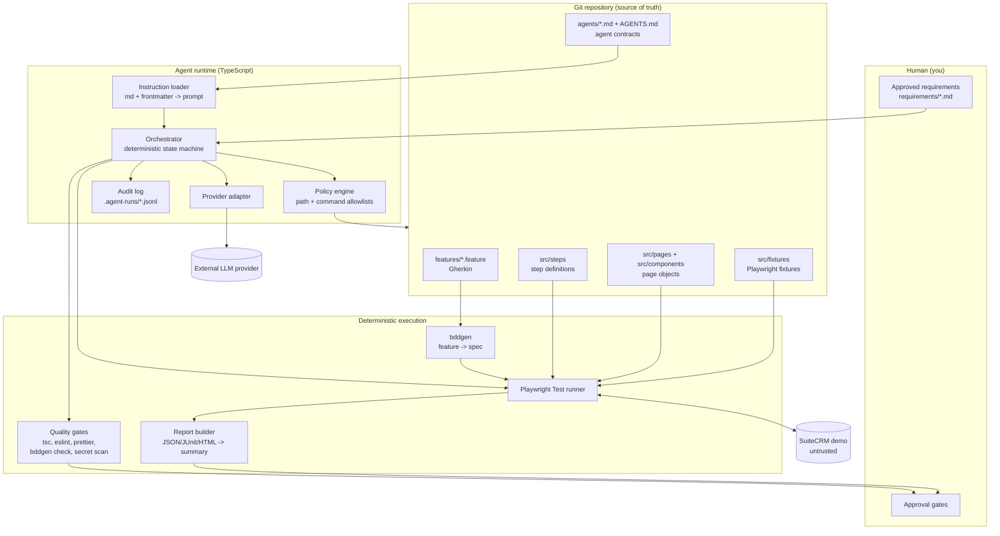
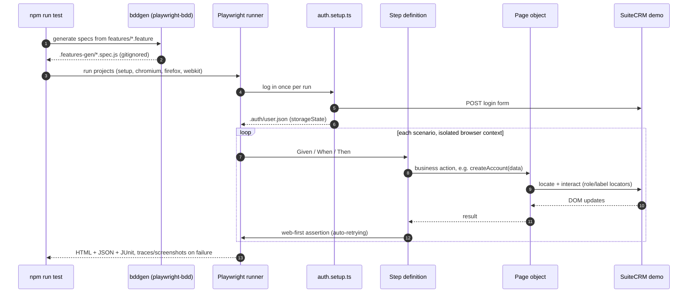
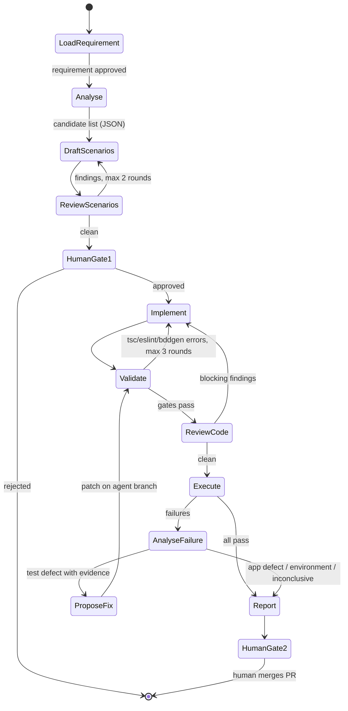
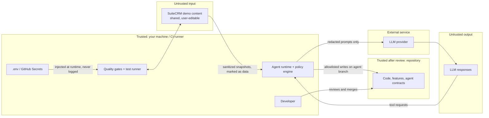

# Architecture

Status: **Proposed (Phase 0)**. Nothing in this document is implemented yet. Each section states what will be built and in which phase.

## 0. Context and target application

| Item        | Decision                                                                                                                  |
| ----------- | ------------------------------------------------------------------------------------------------------------------------- |
| Target      | SuiteCRM public demo, `https://demo.suiteondemand.com/` (classic SuiteCRM 7-style UI; exact version confirmed in Phase 1) |
| Type        | Web application only. No API, database or mobile testing                                                                  |
| Auth        | Username/password form login. Credentials supplied through `.env` (never committed, never pasted in chat)                 |
| Browsers    | Desktop Chromium, Firefox, WebKit. No mobile emulation                                                                    |
| Repo / CI   | Personal GitHub repository, GitHub Actions                                                                                |
| AI provider | Behind an interface; first provider to be chosen (see section 6)                                                          |

### Why not Myntra or Flipkart

Observed on 2026-10-29 from the developer machine:

- `www.myntra.com`: plain HTTP requests timed out, then the connection was reset. Consistent with bot protection; not bypassed by design.
- `www.flipkart.com`: reachable, but its Terms of Use state: _"You shall not use any 'deep-link', 'page-scrape', 'robot', 'spider' or other automatic device, program, algorithm or methodology ... to access, acquire, copy or monitor any portion of the Platform"_. Automated testing would breach this.
- `demo.suiteondemand.com`: reachable, redirects to a login form. It is a vendor-hosted demo intended for hands-on trial.

### Known characteristics of the SuiteCRM demo

- **Shared instance.** Other people use it concurrently and may edit or delete data. Tests must never depend on pre-existing records; every test creates its own uniquely named data (`PWAUTO-<runId>-...`) and cleans up only what it created.
- **Resets periodically.** Data and possibly credentials can change. Failures caused by this are classified as `environment`, not `test defect`.
- **`robots.txt` is `Disallow: /`.** That targets crawlers, not interactive use, but we stay polite: low worker count, no crawling, no load testing.
- **Untrusted content.** Any visitor can type text such as "ignore your instructions" into a record name. Page content is treated as hostile input to AI agents (section 8).

### Candidate business workflows (to confirm in Phase 2 from the live UI)

1. Login and logout (valid and invalid credentials)
2. Accounts: create, view, edit, search, delete own record
3. Contacts: create linked to an account
4. Leads: create and convert to contact/account/opportunity
5. Opportunities: create with sales stage and amount validation
6. Global search and list-view filtering

## 1. High-level architecture



Key idea: **AI proposes, deterministic tools decide.** The LLM never runs a command or writes a file directly; it asks the runtime, the policy engine checks the request, and pass/fail is decided by the compiler, linter and test runner.

## 2. Component responsibility matrix

| Component                          | Responsibility                                                         | Uses LLM? | Phase |
| ---------------------------------- | ---------------------------------------------------------------------- | --------- | ----- |
| `features/`                        | Business behaviour in Gherkin. No technical detail                     | No        | 2     |
| `src/steps/`                       | Map Gherkin lines to page-object calls. No locators                    | No        | 2     |
| `src/pages/`, `src/components/`    | Locators and UI interactions, one class per page or reusable widget    | No        | 2     |
| `src/fixtures/`                    | Inject page objects, test data, run ID into steps; isolation           | No        | 2     |
| `src/config/env.ts`                | Load and validate environment variables (fails fast)                   | No        | 1     |
| `src/data/`                        | Unique test-data builders, cleanup registry                            | No        | 3     |
| `tests/setup/`                     | Login once, save `storageState` for reuse                              | No        | 3     |
| `playwright.config.ts`             | Browsers, workers, retries, timeouts, artifacts, reporters             | No        | 1-3   |
| Quality gates (`npm run validate`) | Format, lint, type check, bddgen, secret scan                          | No        | 1, 5  |
| Report builder (`scripts/`)        | Turn Playwright JSON into a structured summary                         | No        | 8     |
| Orchestrator                       | Run workflows as a fixed state machine, enforce gates and approvals    | No        | 5     |
| Instruction loader                 | Parse `agents/*.md`, validate frontmatter, assemble prompts            | No        | 5     |
| Policy engine                      | Allow/deny file paths, commands, network for each agent                | No        | 5     |
| Audit log                          | Record every prompt hash, tool call, file diff, tokens, verdict        | No        | 5     |
| Application Analysis agent         | Read sanitized page snapshots + requirements, list candidate scenarios | **Yes**   | 6     |
| BDD Scenario agent                 | Write/update `.feature` files from approved scenarios                  | **Yes**   | 6     |
| Test Implementation agent          | Write steps, page objects, fixtures for new scenarios                  | **Yes**   | 6     |
| Test Review agent                  | Review diffs for brittleness, duplication, security; returns findings  | **Yes**   | 6     |
| Failure Analysis agent             | Classify failures from evidence; propose patch on a branch             | **Yes**   | 7     |
| Reporting agent                    | Optional plain-English narrative over the deterministic summary        | Optional  | 8     |

Merges compared to the original 7-agent list: **Orchestrator** and **Execution** are deterministic code, not LLM agents, because sequencing, running tests and deciding pass/fail must be reproducible. **Reporting** is deterministic with an optional LLM summary. That leaves five LLM agents, introduced only when the phase needs them.

## 3. BDD execution flow



`playwright-bdd` converts Gherkin into ordinary Playwright test files, so the Playwright runner keeps all its features: fixtures, parallelism, retries, traces, tags (`@smoke` becomes a grep filter) and reporters.

## 4. Agent orchestration



- Every arrow is code in the orchestrator, not an LLM decision.
- Loops have hard round limits; exceeding them stops the run and hands back to you.
- All agent file changes go to a branch `agent/<runId>`. Merging is always done by you.
- Guided mode pauses at every state; pipeline mode pauses only at `HumanGate1` and `HumanGate2`.

## 5. Proposed repository tree

```text
.
├── AGENTS.md                      # repo-wide rules for every agent and contributor
├── README.md
├── package.json / package-lock.json
├── tsconfig.json                  # strict
├── playwright.config.ts
├── eslint.config.mjs
├── .prettierrc.json
├── .env.example                   # variable names only, no values
├── .gitignore                     # .env, .auth/, reports, .agent-runs/
├── .github/
│   ├── workflows/                 # pr-validation, smoke, regression, agent-run
│   └── dependabot.yml
├── requirements/                  # approved requirements (agent input)
├── features/                      # Gherkin, grouped by business area
│   ├── auth/
│   └── accounts/
├── src/
│   ├── config/env.ts
│   ├── fixtures/
│   ├── steps/
│   ├── pages/
│   ├── components/
│   ├── data/
│   └── support/                   # logging, redaction
├── tests/setup/auth.setup.ts
├── agents/
│   ├── _shared/                   # security rules, output schemas reference
│   ├── application-analysis.md
│   ├── bdd-scenario.md
│   ├── test-implementation.md
│   ├── test-review.md
│   ├── failure-analysis.md
│   ├── reporting.md
│   └── orchestrator.md            # workflow spec the runtime enforces
├── agent-runtime/
│   ├── cli.ts                     # npm run agent -- <workflow>
│   ├── orchestrator.ts
│   ├── loader.ts
│   ├── policy.ts
│   ├── schemas.ts
│   ├── audit.ts
│   ├── tools/                     # read_file, write_file, run_npm_script, ...
│   └── providers/                 # provider.ts + one adapter per provider + fake
├── scripts/                       # validate-agents, summarize-results
└── docs/
    ├── architecture.md
    ├── setup.md
    ├── workflows.md
    ├── troubleshooting.md
    └── decisions/                 # ADRs
```

Generated or local-only (gitignored): `.features-gen/`, `.auth/`, `test-results/`, `playwright-report/`, `.agent-runs/`, `.env`.

## 6. How Markdown becomes agent behaviour

Markdown files do nothing on their own. The runtime turns them into behaviour in six steps:

1. **Contract.** Each `agents/<name>.md` starts with YAML frontmatter that the runtime enforces, followed by prose sections that become the system prompt:

   ```yaml
   ---
   id: bdd-scenario
   version: 1.0.0
   tools: [read_file, list_files, write_file]
   writable_paths: ['features/**/*.feature']
   readable_paths: ['features/**', 'requirements/**', 'src/steps/**']
   output_schema: ScenarioDraftResult
   max_turns: 8
   max_output_tokens: 8000
   ---
   ```

2. **Load and validate.** `loader.ts` parses the file and validates the frontmatter with a zod schema. `npm run validate:agents` runs the same check in CI, so a broken contract fails the build before any agent runs.
3. **Assemble prompt.** System prompt = `AGENTS.md` + `agents/_shared/security.md` + the agent's body. Task input is passed as structured JSON; any application content is wrapped and labelled as untrusted data.
4. **Restrict tools.** Only the tools named in `tools` are offered to the model. Each call is checked by `policy.ts`: resolved real path must match `writable_paths`, commands must be named npm scripts on an allowlist, no shell strings, no network tools.
5. **Validate output.** The model's final answer must parse against `output_schema` (zod). Invalid output is retried once with the validation error, then the run fails.
6. **Gate and record.** Changed files go through the deterministic quality gates. Everything is appended to `.agent-runs/<runId>.jsonl`: agent id and version, prompt hash, tool calls, diffs, token usage, gate results.

### AI provider options (decision pending)

You have no API key. The provider sits behind one interface, so the choice affects only one adapter file:

| Option                             | Cost                           | Works in GitHub Actions                     | Notes                                                                                                  |
| ---------------------------------- | ------------------------------ | ------------------------------------------- | ------------------------------------------------------------------------------------------------------ |
| GitHub Models                      | Free tier, rate-limited        | Yes, via `GITHUB_TOKEN` with `models: read` | Uses your personal GitHub account; OpenAI-compatible API with tool calling                             |
| Claude Code headless (`claude -p`) | Your existing Claude Code plan | Only with a separate token                  | Strong code quality. Check that using your employer-provided account for a personal project is allowed |
| Ollama (local model)               | Free                           | Not practical                               | Fully private; needs RAM/GPU; weaker at code generation                                                |
| Anthropic / OpenAI API             | Paid per token                 | Yes                                         | Add later if needed                                                                                    |

A **fake provider** that replays recorded responses is built regardless. It lets us test the orchestrator, policy engine and approval gates in CI without any key or cost.

## 7. Dependency and tooling selection

Exact versions are verified against npm and pinned via the lockfile at install time (Phase 1 onward). No version is assumed here.

| Package / tool                                            | Purpose                                               | Phase | Why this one                                       |
| --------------------------------------------------------- | ----------------------------------------------------- | ----- | -------------------------------------------------- |
| `@playwright/test`                                        | Browser automation + runner                           | 1     | Built-in fixtures, parallelism, traces, retries    |
| `typescript`, `@types/node`                               | Static typing                                         | 1     | Strict mode catches AI mistakes early              |
| `eslint`, `typescript-eslint`, `eslint-plugin-playwright` | Linting                                               | 1     | Flags fixed waits, missing awaits, weak assertions |
| `prettier`                                                | Formatting                                            | 1     | Removes style debates and noisy diffs              |
| `zod`                                                     | Runtime validation of env, frontmatter, agent outputs | 1     | One schema library for all three                   |
| `dotenv`                                                  | Load `.env` locally                                   | 1     | CI uses GitHub Secrets instead                     |
| `playwright-bdd`                                          | Gherkin on the Playwright runner                      | 2     | Avoids a second runner (Cucumber.js)               |
| `tsx`                                                     | Run TypeScript scripts directly                       | 4     | For the agent CLI and scripts                      |
| `gray-matter`                                             | Parse Markdown frontmatter                            | 4     | Small, widely used                                 |
| Provider SDK                                              | LLM calls                                             | 5     | Chosen after the provider decision                 |
| gitleaks (CI action)                                      | Secret scanning                                       | 8     | Blocks committed credentials                       |
| Dependabot + `npm audit`                                  | Dependency updates and vulnerabilities                | 8     | Native to GitHub                                   |

Deliberately not included: Cucumber.js, Selenium, Allure (optional later), LangChain or other agent frameworks (the orchestration needed is small enough to own and test directly), Docker (GitHub-hosted runners with Playwright's install step are enough).

## 8. Security and trust boundaries



| Threat                             | Control                                                                                                                  |
| ---------------------------------- | ------------------------------------------------------------------------------------------------------------------------ |
| Committed credentials              | `.env` gitignored, `.env.example` names only, gitleaks in CI                                                             |
| Credentials in artifacts           | Login runs in setup project only; traces for setup disabled; redaction helper for logs                                   |
| Prompt injection from page content | Snapshots wrapped as data, instructions say never follow them, agents have no network or shell, outputs schema-validated |
| Agent writes outside its scope     | Real-path check against `writable_paths`; symlinks and `..` rejected                                                     |
| Agent runs arbitrary commands      | Only named npm scripts; no shell string execution                                                                        |
| Agent weakens tests to pass        | Review agent + deterministic diff check that flags removed or loosened assertions; human merge                           |
| Data sent to provider              | Only redacted snapshots, code and error text; screenshots and traces stay local unless you approve                       |
| Runaway cost / loops               | Per-agent turn and token caps, round limits, run-level budget                                                            |
| Damage to the shared demo          | Only records prefixed `PWAUTO-<runId>` are edited or deleted; worker count kept low                                      |

## 9. Key decisions and trade-offs

| Decision                               | Alternative                      | Trade-off                                                                                                                     |
| -------------------------------------- | -------------------------------- | ----------------------------------------------------------------------------------------------------------------------------- |
| SuiteCRM demo as target                | Myntra / Flipkart                | Loses e-commerce flavour; gains legality, reachability and real CRUD workflows with login. Shared data adds environment noise |
| `playwright-bdd`                       | Cucumber.js + Playwright library | Ties us to Playwright's runner, which is what we want                                                                         |
| Page Object Model + components         | Screenplay pattern               | Simpler to learn and review; Screenplay is more flexible for very large suites                                                |
| Deterministic orchestrator             | LLM orchestrator agent           | Less "autonomous", but reproducible and testable                                                                              |
| Five LLM agents, added gradually       | Seven agents from the start      | Fewer prompts to maintain; split later only if quality demands                                                                |
| Own small runtime                      | LangChain / agent framework      | More code to own, but fully understandable and no hidden behaviour                                                            |
| Branch + human merge for agent changes | Agents commit to main            | Slower, but every AI change is reviewable                                                                                     |
| Log in once via storageState           | Log in per scenario              | Faster and gentler on the demo; login scenarios still test the form explicitly                                                |

ADRs for these decisions are written to `docs/decisions/` in Phase 1.

## 10. Phased roadmap and acceptance criteria

| Phase                    | Deliverables                                                                                                              | Acceptance criteria (evidence required)                                                                                                                                    |
| ------------------------ | ------------------------------------------------------------------------------------------------------------------------- | -------------------------------------------------------------------------------------------------------------------------------------------------------------------------- |
| 1. Playwright foundation | git init, package.json, strict tsconfig, Playwright config, ESLint/Prettier, env validation, one login-page test, ADRs    | `npm ci` clean; `npm run typecheck`, `lint`, `format:check` exit 0; test opens the demo and asserts the login form in Chromium; missing env var fails with a clear message |
| 2. BDD integration       | playwright-bdd, `login.feature`, steps, LoginPage + HomePage, fixtures                                                    | `npm test` runs a real Gherkin scenario; failure produces trace and screenshot; `@smoke` filter selects it                                                                 |
| 3. Framework engineering | auth setup project, data builders with cleanup, 3 browser projects, tags, retries, artifact policy, Accounts CRUD feature | Same suite passes in all 3 browsers; 2 parallel workers create non-colliding data; cleanup removes only own records; `--repeat-each=3` stable                              |
| 4. Agent contracts       | `AGENTS.md`, 7 agent files, shared rules, frontmatter schema, `validate:agents`                                           | Validator passes; deliberately broken contract fails it                                                                                                                    |
| 5. AI integration        | Runtime, provider adapter + fake provider, policy engine, audit log                                                       | One bounded task (e.g. review an existing feature) completes; out-of-scope write is rejected and logged; budget cap stops a run                                            |
| 6. Test generation       | Requirement → scenario → implementation workflow with gates                                                               | Generated feature and code pass all gates and run green against the demo, on an agent branch, after your approval                                                          |
| 7. Failure analysis      | Classifier + fix proposal                                                                                                 | Injected locator break is classified as test defect with evidence and fixed on a branch; injected assertion change is never "fixed" by loosening                           |
| 8. CI/CD and reporting   | PR validation, smoke on push, scheduled regression, artifacts, summary report, secret scan, Dependabot                    | Workflows green on GitHub; failing test fails the job; report separates test, environment and agent failures                                                               |
| 9. Production readiness  | Checklist run, docs complete, limitations documented                                                                      | Fresh clone set up from `docs/setup.md` alone; every Definition-of-Done item has linked evidence or is marked unverified                                                   |
